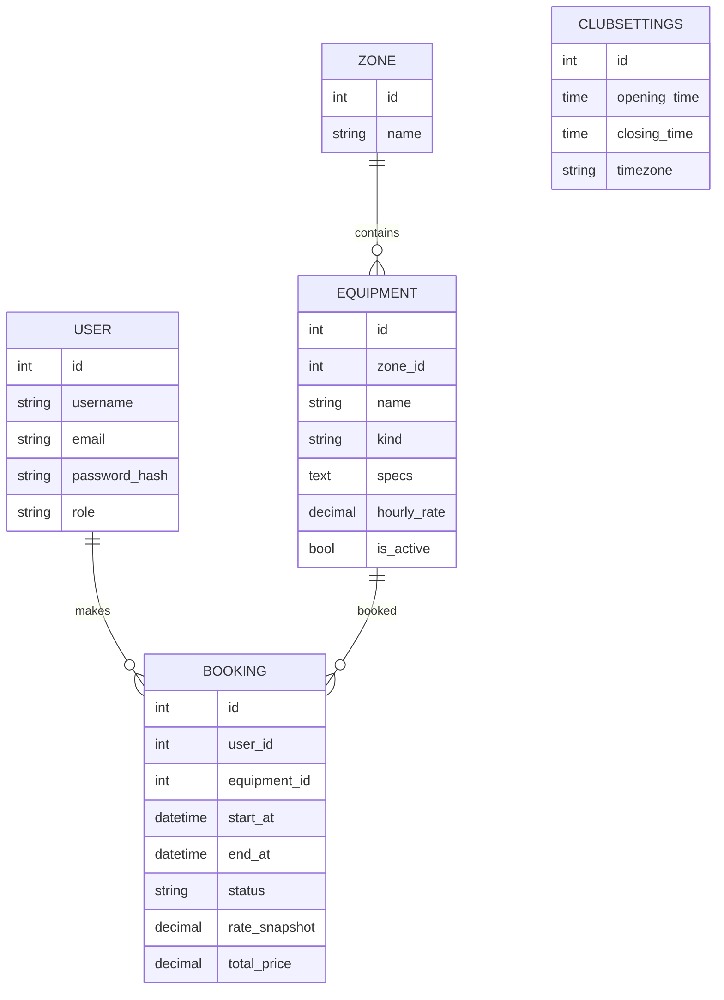

# GameTime — бронирование игрового клуба

Django 5.2 + SQLite, серверные шаблоны, один CSS-файл и два небольших JS-файла (без сборщиков).

## Запуск на чистой базе

```bash
python -m venv .venv && source .venv/bin/activate      # Windows: .venv\Scripts\activate
pip install -r requirements.txt
python manage.py makemigrations core                    # первый запуск: создаёт миграции, закоммитьте их
python manage.py migrate
python manage.py seed_demo                              # 2 зоны, 8 устройств, 3 клиента, 15 броней
python manage.py test                                   # автотесты бизнес-правил и прав
python manage.py runserver
```

Открыть: http://127.0.0.1:8000/

Демо-аккаунты (вымышленные): `admin / admin12345` (администратор), `aida`, `bakyt`, `emil` / `client12345` (клиенты).
Пересоздать данные: `python manage.py seed_demo --reset`.

## Что реализовано (MVP)

| Требование ТЗ | Где |
|---|---|
| Каталог, фильтры тип/зона, доступность на дату, пагинация | `views.catalog`, `catalog.html` |
| Слоты по 30 минут, занятые интервалы, сумма до подтверждения | `services.build_slots`, `static/js/booking.js`, `GET /equipment/{id}/slots?date=` |
| Бронь «подтверждена», отмена до начала, старт / завершение / неявка | `services.change_status`, `POST /bookings/{id}/cancel\|start\|finish\|no-show` |
| Цена на сервере, фиксация тарифа и суммы в брони | `services.calc_price`, поля `rate_snapshot`, `total_price` |
| Рабочие часы одним интервалом без перехода через полночь | `ClubSettings`, `/manage/settings/` |
| Нет пересечений, атомарно + блокировка устройства | `services.create_booking` (`transaction.atomic` + `select_for_update`) |
| Панель: календарь дня, фильтр по статусу, отчёт | `/club/`, `/reports/utilization` |
| Роли и права на сервере, 403/404 | `admin_required`, `change_status`, `403.html`, `404.html` |
| Редактор оборудования, зон, пользователей и ролей | `/manage/equipment/`, `/manage/users/` |

## Модель данных



Обоснования: внешние ключи `PROTECT` (историю не удаляем каскадом); `CheckConstraint` на `end_at > start_at` и `total_price >= 0`;
индексы `(equipment, start_at, end_at)`, `(status, start_at)`, `(user, start_at)`, `(kind, is_active)`;
`UniqueConstraint(zone, name)` для устройств.

## Важно про конкурентные брони

Проверка пересечения и запись выполняются внутри транзакции после `select_for_update()` строки устройства.
На PostgreSQL это даёт реальную блокировку: два одновременных запроса выстроятся в очередь и вторая получит 409.
SQLite сериализует записи на уровне файла, поэтому для демонстрации критерия «два запроса — одна бронь» тоже подходит,
но для защиты лучше показать на PostgreSQL (смените `ENGINE` в `config/settings.py`).

## Структура

```
config/            настройки, urls
core/models.py     User, Zone, Equipment, ClubSettings, Booking
core/services.py   правила бронирования, переходы статусов, отчёт
core/views.py      страницы, формы, права
core/tests.py      автотесты
templates/, static/
```

План реализации — в `PLAN.md`.
